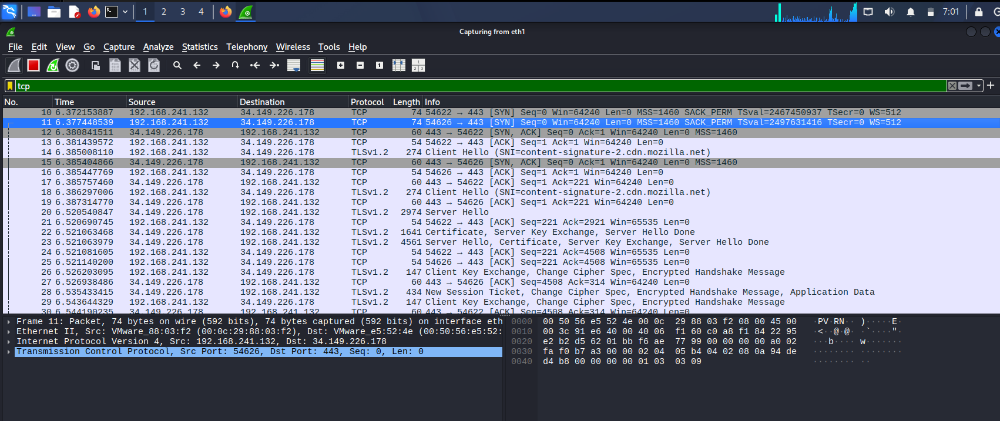
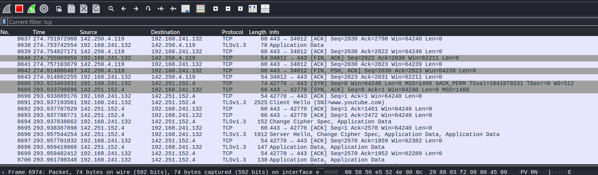

# Day 02 - How Traffic Actually Moves

**Date:** 12 August 2026
**Goal:** Understand how traffic actually moves and check it in Wireshark - TCP vs UDP, Three Way Handshake, Common Ports.

---

## TCP vs UDP

**TCP:** TCP (Transmission Control Protocol) is a connection-oriented protocol. A connection must be established between two computers before any data is sent.

- eg. HTTPS, FTP.
- In TCP we can perform the 3 way handshake.
- It is slower compared to UDP.
- It is highly reliable - lost packets are re-sent and data arrives in the correct order.

**UDP:** UDP (User Datagram Protocol) is connectionless. If we need to do something fast, then we use UDP.

- eg. DHCP, DNS, TFTP, Online Streaming.
- In UDP we cannot perform the 3 way handshake.
- It is faster.
- It is not reliable - there is no re-sending and no ordering, packets can be lost.

## Three Way Handshake

It is also called the TCP Handshake. In this we send a request to the server, the server accepts it and gives permission to access the response. It is a 3 step method, that is why it is called the 3 way handshake. In this we use SYN, SYN-ACK and ACK.

               Client                                     Server

                        -----------SYN seq = x----------

               Computer ---seq = y, ack = x+1 SYN-ACK---   eg. Google

                        ---------ACK ack = y+1----------

**1. SYN:** SYN (Synchronize Sequence Number) - the client sends a SYN request to get access to the server. In this it mentions the sequence number it is starting from.

**2. SYN-ACK:** In the 2nd step the server sends back an acknowledgement (ACK) to the client along with its own sequence number.

**3. ACK:** In the last step the client confirms with an ACK that it got access. After this the client and server are connected successfully.

Point to remember: the ACK number is always the sequence number that was received + 1. That is how each side confirms it got the other side's packet.

In the 3 way handshake the sender and receiver exchange segments to establish a reliable connection.

## Common Ports

Network ports are assigned numbers from 0 to 65535 that direct internet traffic to the correct service on the computer.

Port 20/21 : FTP (move files between computers - 20 is data, 21 is commands)
Port 22 : SSH/SFTP (secure command line and file access)
Port 23 : Telnet (older, unencrypted remote login)
Port 25 : SMTP (transfer mail between servers)
Port 53 : DNS (translates website names into IP addresses)
Port 80 : HTTP (unencrypted web traffic)
Port 110 : POP3 (download email from server)
Port 143 : IMAP (sync email on server)
Port 443 : HTTPS (secure, encrypted web traffic)
Port 445 : SMB (server message block - file sharing, printer sharing)
Port 3389 : RDP (Windows remote desktop)

## TryHackMe Room 1 and 2

- **Offensive Security Intro:** In this room we saw how a hacker checks a vulnerable website and hacks it. We were given a fake bank website. We used the tool **DirBuster** to find hidden pages on the site. After finding a hidden page, we directly accessed the admin panel and increased the bank account balance from there.

- **Defensive Security Intro:** In this room they showed how a SOC analyst finds the attacker and blocks them. We used a **SOC Dashboard** to check the alerts and find which one was the real attack. After identifying it, we checked the attacker's IP and blocked it to stop the attack. So in the offensive room we performed the attack on the fake bank, and in the defensive room we stopped that same kind of attack, blocked the IP and reduced the timeline.

## Checking the Three Way Handshake in Kali using Wireshark

We checked how the 3 way handshake is performed in Kali using **Wireshark**. Wireshark is a packet capture tool that captures all the packets moving on the network.

Steps I followed:

1. Opened Wireshark and selected the **eth1** interface, because that is our IP and we only want to check our own traffic.
2. Opened Firefox and went to Google.
3. Came back to Wireshark and applied the filter `tcp`, because TCP is the one that performs the handshake. This way only TCP packets are shown.
4. Found the SYN, SYN-ACK and ACK packets at the start of the connection.

Tip: the filter `tcp.flags.syn == 1 && tcp.flags.ack == 0` shows only the connection starts, which makes the handshake much easier to spot.

After that I opened YouTube and checked there also. That image is shared below so you can see how to check it.

Note: on Google and YouTube, after the TCP handshake you will also see a TLS handshake (Client Hello / Server Hello). That is the encryption layer, which is separate from TCP.

---

That is it for today. We did a lot of things - we learnt the theory like TCP vs UDP, what is the 3 way handshake, and the common ports we use. Then for practical we completed 2 TryHackMe rooms, Offensive Intro and Defensive Intro. After that, in our own system, we checked the 3 way handshake practically and saw how it works and how it shows in Wireshark.

Thank You....
